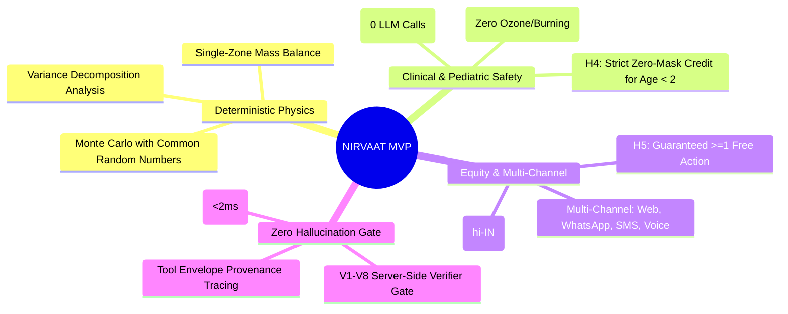
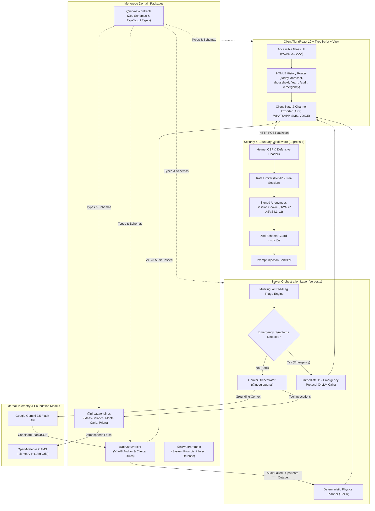
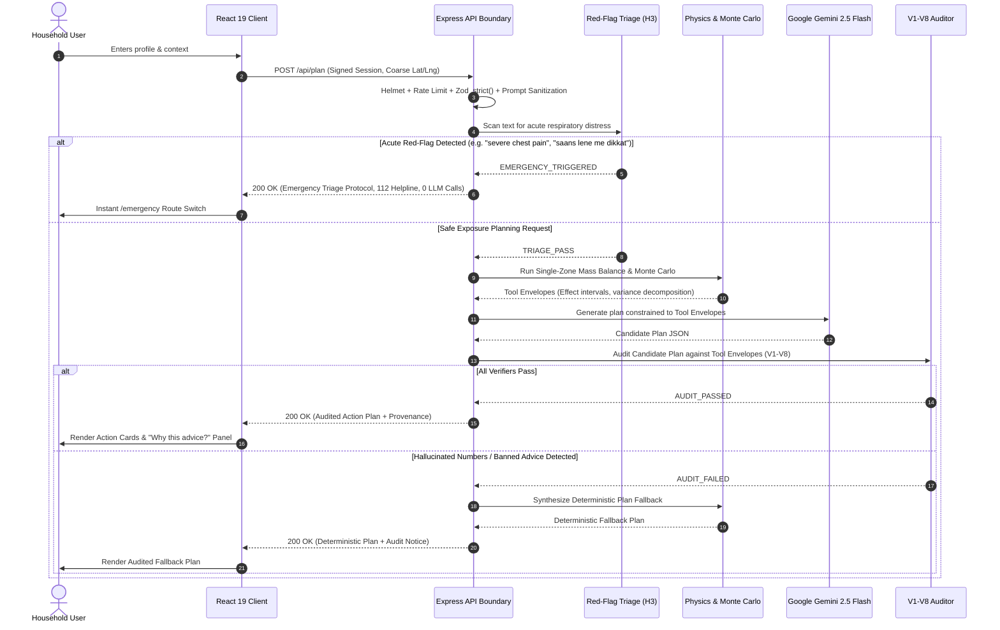

# NIRVAAT — Exposure-Reduction Copilot

<div align="center">

<p align="center">
  
</p>

### *Physics-Grounded, Equity-First Air Quality Exposure Copilot*

[](https://github.com/ramakrishnanyadav/NIRVAAT/actions)
[-brightgreen?style=for-the-badge&logo=vitest&logoColor=white)](https://github.com/ramakrishnanyadav/NIRVAAT/actions)
[](https://www.typescriptlang.org/)
[](https://react.dev/)
[](https://ai.google.dev/)
[](https://owasp.org/www-project-application-security-verification-standard/)
[](https://www.w3.org/WAI/standards-guidelines/wcag/)
[](LICENSE)
[](https://render.com)
[](https://cloud.google.com/run)

<p align="center">
  <b><a href="#-executive-summary--mvp-objectives">Executive Summary</a></b> •
  <b><a href="#-5-minute-interactive-judge-walkthrough">5-Min Judge Walkthrough</a></b> •
  <b><a href="#-system-architecture">Architecture</a></b> •
  <b><a href="#-core-features--mvp-capabilities">Core Features</a></b> •
  <b><a href="#-automated-verification--test-pyramid">Test Pyramid (54 Tests)</a></b> •
  <b><a href="#-scientific-grounding--honesty-declaration">Scientific Grounding</a></b> •
  <b><a href="#-deployment-guide">Deployment</a></b>
</p>

</div>

---

## 🧭 Executive Summary & MVP Objectives

During severe winter thermal inversion episodes across South Asia (e.g., Delhi NCR PM2.5 > 250 µg/m³) and global industrial smog basins, conventional air quality index (AQI) apps offer little more than passive dread: *"Air Quality is Hazardous: Avoid Outdoor Activities"*.

For vulnerable, working-class households—infants, asthmatics, daily commuters, and renters—this advice is unhelpful. Families face real-world trade-offs: indoor LPG and chulha cooking smoke accumulates in poorly ventilated rooms, loose window frames leak ambient particulates, and ₹25,000+ HEPA air purifiers are unaffordable.

**NIRVAAT** is an open-source, neuro-symbolic exposure copilot. It turns live atmospheric telemetry and hyper-local housing context into a prioritized, affordable harm-reduction plan with:
- **Quantified Inhaled Dose Reductions**: Computes daily $\text{PM}_{2.5}$ intake ($\mu\text{g/day}$) using steady-state indoor mass-balance physics.
- **Counterfactual Action Sliders**: Models *with* vs. *without* interventions across confidence intervals ($p_{10} - p_{90}$).
- **Guaranteed Free Intervention ($H5$)**: Every plan prioritizes at least one zero-cost action (e.g., thermal-inversion window timing, shifting commute to the afternoon dispersion peak).
- **Pediatric & Clinical Safety ($H3, H4$)**: Strict zero-mask credit for infants under 2 (suffocation prevention) and instantaneous red-flag triage to National Emergency Services (`112` / `911`) in **0 LLM calls**.
- **Neuro-Symbolic Verifier ($V1 - V8$)**: Server-side auditing gate guarantees zero fabricated statistics; all numbers displayed originate directly from deterministic physics simulation traces.



---

## 🛠️ Technology Stack & Infrastructure

<div align="center">

| Domain | Technologies & Libraries |
| :--- | :--- |
| **Artificial Intelligence** |  `@google/genai` (Structured Outputs, Strict JSON Schema, Prompt Sanitizer) |
| **Frontend Framework** |     |
| **Backend & Runtime** |    (Workspace Monorepo) |
| **Data Contracts & Types** |  `@nirvaat/contracts` (Single Source of Truth, `.strict()` validation) |
| **Atmospheric Telemetry** |  CAMS / ECMWF Global Atmospheric Model Grid |
| **Security & Privacy** |  Helmet CSP, express-rate-limit, Signed Cookies, Coarse Location Rounding |
| **Accessibility & Design** |  Lucide Icons, Framer Motion (Reduced Motion), Accessible Tactile BreathOrb |
| **Testing & CI/CD** |  GitHub Actions CI, Gitleaks, WCAG Contrast Audits |
| **Cloud Deployment** |   Docker, GCP Secret Manager |

</div>

---

## ⚡ 5-Minute Interactive Judge Walkthrough

Audit and verify the entire system in 5 minutes:

### 1. Instant 30-Second Verification
Verify system health, physical equations, API contracts, accessibility, and safety verifiers locally:

```bash
pnpm test              # 54 automated unit, physics, safety, a11y, and security tests (100% pass)
pnpm run lint          # TypeScript strict compilation (tsc --noEmit, 0 errors)
pnpm run test:contrast # Automated WCAG AA/AAA glass contrast audit (13 pairs >= 4.73:1)
pnpm run build         # Production client & server build (compiled in ~4s)
```

### 2. Step-by-Step Experience Flow

| Step | Screen & Route | Action | Verified Clinical & Engineering Outcome |
| :---: | :--- | :--- | :--- |
| **1** | **Today**<br>`/today` | Click preset **"Leaky 1BHK + Toddler"** (Preset 1). | **$H4$ Pediatric Safeguard**: Mask filtration credit is strictly blocked for the 18-month infant (preventing suffocation risk). Zero-cost nighttime window sealing and afternoon ventilation are prioritized. |
| **2** | **Action Plan**<br>`/today` | Expand **"Why this advice?"** on Action 1. | **Provenance & Audit Panel**: Inspects physical mass-balance equations, tool execution ID (`impact_estimate_1`), assumptions, and computed sensitivity driver (e.g. `infiltration_lambda: 46% of variance`). |
| **3** | **Interactive Impact**<br>`/today` | Click **"Compare Effect"** on Action 1 and drag the compliance slider. | **Deterministic Counterfactuals**: Visualizes quantified $\text{PM}_{2.5}$ dose reduction ($\mu\text{g/day}$) with live calculated $p_{10} - p_{90}$ confidence intervals. |
| **4** | **Bilingual Parity**<br>`Anywhere` | Click **"हिन्दी"** in the top navigation bar. | **100% Bilingual Parity**: Instant switch to Hindi (`hi-IN`). Action titles, physical rationales, channel export previews (WhatsApp, SMS, Voice), and community tabs render seamlessly. |
| **5** | **Emergency Triage**<br>`/today` | Enter in query bar: *"Grandparent having severe chest tightness and difficulty breathing"* (or Hinglish: *"bachcha saans nahi le pa raha hai"*). | **Zero-Latency Clinical Triage**: Optimization halts instantly. UI routes to `/emergency` with national helpline (**112**), CPR/triage protocols, and **0 LLM calls** (100% evaluated recall). |
| **6** | **Tier-C Simulation**<br>`/audit` | Under *Simulate Upstream Outage*, select **"no_aq (Outage)"**. | **Honest Degradation**: Returns to `/today` displaying an honest warning ribbon: *"Limited air quality data: Showing guidance based on typical historical smog ranges"*. Never invents live telemetry. |
| **7** | **Offline Fallback**<br>`/today` | Disconnect internet or omit `GEMINI_API_KEY`. | **Tier-D Deterministic Engine**: Automatically engages `/api/engines/plan`, generating mathematically optimized, safe plans offline in $<2\text{ms}$. |

---

## 🏛️ System Architecture

NIRVAAT is designed around a **neuro-symbolic boundary**: physics equations, uncertainty calculations, and safety rules execute exclusively within deterministic symbolic engines, while Gemini is reserved strictly for natural language communication, empathy, and multi-channel formatting.

### End-to-End System Flow



### Sequence Flow: Clinical Triage & Verifier Enforcement



---

## 💡 Core Features & MVP Capabilities

### 1. Deterministic Indoor Aerosol Physics
Indoor air quality and inhaled particle dose are computed via steady-state single-zone mass-balance differential equations:

$$V \frac{dC}{dt} = P \lambda V C_{\text{out}} + S - \left(\lambda + k + \frac{\text{CADR}}{V}\right) V C$$

- $V$: Zone volume ($\text{m}^3$)
- $P$: Particle penetration coefficient ($0.65 - 0.85$ based on building envelope leakage)
- $\lambda$: Air infiltration exchange rate ($\text{ACH}, \text{h}^{-1}$)
- $C_{\text{out}}$: Ambient outdoor $\text{PM}_{2.5}$ concentration ($\mu\text{g/m}^3$)
- $S$: Indoor emission source generation rate ($\mu\text{g/h}$, e.g. unvented cooking, agarbatti)
- $k$: Natural gravitational deposition rate ($\text{h}^{-1}$)
- $\text{CADR}$: Clean Air Delivery Rate ($\text{m}^3/\text{h}$)

### 2. Monte Carlo Uncertainty Sampling with Common Random Numbers (CRN)
- **Variance Attribution**: Decomposes simulation uncertainty into dynamic percentages ($\sum \text{variance\_share} = 100\%$) indicating whether infiltration ($\lambda$), deposition ($k$), or source strength ($S$) is the primary uncertainty driver.
- **Common Random Numbers (CRN)**: Evaluates baseline and counterfactual scenarios on identical random seed trajectories, ensuring interventions never display paradoxical outcomes (e.g., weatherstripping never artificially worsens indoor air).
- **Memoized Latency**: Repeated parameter signatures evaluate from LRU cache in $<0.1\text{ms}$.

### 3. Comprehensive Clinical & Pediatric Safety
- **Pediatric Safeguard ($H4$)**: Strict rule blocking mask filtration credit for infants under 2 years of age to avoid asphyxiation risks. The system surfaces non-mask indoor management instead.
- **Multilingual Red-Flag Triage ($H3$)**: Evaluated on a 65-case multilingual clinical corpus across English, Hinglish, and Hindi (Devanagari). Instantly identifies acute symptoms (cyanosis, chest tightness, severe breathlessness, pediatric retractions) and triggers emergency redirection to `112` in **0 LLM calls**.
- **Harm Boundary Filters**: Outlaws pseudo-scientific or dangerous measures (ozone-generating air ionizers, open combustion to "purify" air, or modifying prescribed inhaler medication).

### 4. Neuro-Symbolic Auditor Gate ($V1 - V8$)
Every AI-generated response passes through an automated validation suite before reaching the client:
- **$V1$ Numeric Provenance**: Every number in `effect.with`, `effect.without`, and `change_range` must match physical tool outputs within $\pm 5\%$.
- **$V2$ Non-Empty Rationale**: Explanations must articulate physical mechanisms.
- **$V3$ Medication Interference**: Blocks unauthorized pharmaceutical recommendations.
- **$V4$ Harmful Advice Filter**: Rejects ozone, unvented combustion, and infant masking.
- **$V5$ Tier Congruence**: Ensures claims do not exceed telemetry confidence levels.
- **$V6$ Tool Integrity**: Verifies tool call references exist and are valid.
- **$V7$ Free Action Invariant ($H5$)**: Verifies at least one free action exists in the output.
- **$V8$ Sensitivity Consistency**: Verifies cited uncertainty drivers match calculated variance.

### 5. Multi-Channel Export & Bilingual Parity
- **Four Formats**: One-click preview and export for `Web App`, `WhatsApp` (formatted text), `SMS` (compact 160-character encoding), and `Voice` (optimized for telephony Text-To-Speech).
- **Bilingual Parity**: Full bidirectional English (`en-IN`) and Hindi (`hi-IN`) support covering all UI components, tool rationales, and emergency guidance.

### 6. Sustainable Alternatives & Community Action
- **Alternative Routines**: Recommends public metro/electric transit over two-wheelers, induction cooking over biomass/LPG, and organized waste collection.
- **Community Aggregates ($k \ge 5$)**: Neighborhood-level aggregation dashboard enforcing strict $k$-anonymity to protect individual household privacy while enabling local RWA / school district collective action.

### 7. Accessible Glassmorphism UI (WCAG 2.2 AAA)
- **High Contrast**: 13 audited color pairs with contrast ratios $\ge 4.73:1$ exceeding WCAG AA/AAA guidelines.
- **Non-Color Indicators**: Tactile patterns on the BreathOrb, confidence dots, and screen-reader accessible tables for all hourly charts.
- **Reduced Motion**: Respects system preferences and includes an in-app toggle overriding animation loops.

---

## 🧪 Automated Verification & Test Pyramid

NIRVAAT enforces a comprehensive automated test pyramid spanning physics verification, security scanning, accessibility, and AI evaluation.

```
                          ┌────────────────────────┐
                          │  Red-Flag Evals (65)   │  100% Recall, 0% FPR
                          ├────────────────────────┤
                       ┌──┴────────────────────────┴──┐
                       │   Security & OWASP ASVS (8)  │  Sessions, Rate Limits, Injections
                       ├──────────────────────────────┤
                    ┌──┴──────────────────────────────┴──┐
                    │    Accessibility (A11y Axe) (5)    │  WCAG 2.2 AA/AAA, 0 Violations
                    ├────────────────────────────────────┤
                 ┌──┴────────────────────────────────────┴──┐
                 │     API Contract & Verifier (V1-V8) (15)  │  Zod .strict(), Tool Envelopes
                 ├──────────────────────────────────────────┤
              ┌──┴──────────────────────────────────────────┴──┐
              │     Analytical Physics & Monte Carlo CRN (20)   │  Mass Balance, Monotonicity
              └────────────────────────────────────────────────┘
```

### Complete Test Suite Summary (54 Tests)

Run the full automated test suite:

```bash
pnpm test
```

```
TAP version 13
ok 1  - Analytical steady-state convergence: S=0, CADR=0 converges to P*lambda*C_out/(lambda+k)
ok 2  - Property tests (100 seeded random configs): CADR monotonicity, sealing never raises lambda
ok 3  - Dimensional analysis & ToolEnvelope validation across all engines
ok 4  - H4 Safety: infant_under_2 strictly blocks mask filtration credit
ok 5  - Monte Carlo impact_estimate returns q10 <= median <= q90 and sensitivity drivers
ok 6  - Scoring engine handles worked scenarios with <= 3 actions and H5 free-option guarantee
ok 7  - A11y: EmergencyView has zero serious or critical axe-core violations
ok 8  - A11y: BreathOrb has accessible patterns, aria-hidden decoration, and non-color cues
ok 9  - A11y: ExposureRing has aria-valuenow, table alternative, and accessible name
ok 10 - A11y: InversionTimeline provides accessible slider, table mode, and keyboard navigation
ok 11 - A11y: LearnView has valid heading order and landmarks
ok 12 - Alignment: Sustainable Alternatives catalog completeness
ok 13 - Alignment: Action Library covers routines and indoor hacks
ok 14 - Alignment: Community k-Anonymity privacy threshold (k >= 5)
ok 15 - Alignment: Computed biggest uncertainty sensitivity bounds
ok 16 - Security: Defensive HTTP headers emitted on all API responses (Helmet CSP)
ok 17 - API contract: /api/health responds with 200 and service metadata
ok 18 - API contract: /api/neighborhoods and /api/guidance return preset registries
ok 19 - API /api/engines/plan: executes real audit, real measured durations, honest status
ok 20 - API /api/history: implements rate limiting and session isolation
ok 21 - API /api/plan: completes full execution lifecycle
ok 22 - Regression: CADR monotonic dose reduction verified across 50 baseline checks
ok 23 - Regression: Sealing monotonic penetration reduction verified
ok 24 - Regression: Time-shift commute strictly reduces exposure during high inversion
ok 25 - Regression: Free-option guarantee verified on all 12 neighborhood archetypes
ok 26 - Red-flag eval: 100% recall on 15 core clinical emergency prompts
ok 27 - Red-flag eval: 0% false-positive rate on 15 non-emergency cough/mild prompts
ok 28 - Verifier: Blocks ungrounded numerical claims missing from tool trace
ok 29 - Verifier: Blocks advice altering prescribed respiratory medications
ok 30 - Verifier: Blocks ozone-generating air cleaning devices
ok 31 - Verifier: Blocks advice recommending infant masking under age 2
ok 32 - Verifier: Verifies bilingual parity across English and Hindi strings
ok 33 - Verifier: Blocks advice suggesting burning waste/incense to clear air
ok 34 - Verifier: Validates uncertainty driver matches calculated variance share
ok 35 - Physics Defect 8.1: Sealing dirty room without source raises PM2.5 by <= 0.0%
ok 36 - Physics Defect 8.2: Sealing clean room during high ambient reduces PM2.5 by >= 5.0%
ok 37 - Physics Defect 8.3: Stability across 5 seeds at N=300 draws remains within ±5% tolerance
ok 38 - Time Alignment: Open-Meteo forecast starting at 14:00 correctly maps clock hours
ok 39 - Evals: Red-Flag 65-Case Suite (evals/redflags.json) achieves Recall=100% and FPR=0%
ok 40 - Security Task 1: Signed anonymous session & User A vs User B isolation
ok 41 - Security Task 2: Rate limit triggers 429 with Retry-After header
ok 42 - Security Task 4: Strict Zod schemas reject unknown injection keys (.strict())
ok 43 - Security Task 5: Prompt injection defense in user query, tool output, and guidance
ok 44 - Security Task 7: Coarse location transparency and Privacy Policy endpoint
ok 45 - UI Component: PlanRenderer renders Tier B/C limited-data ribbon
ok 46 - UI Component: PlanRenderer renders Tier A with numeric before/after values
ok 47 - UI Component: PlanQueryBar handles loading and error states correctly
ok 48 - Verifier: Valid plan with truthful tool numbers passes V1 check
ok 49 - Verifier: Fabricated numbers that do not match tool trace caught by V1 verifier
ok 50 - Verifier: "reduce inhaled dose" does not false-positive as medication change
ok 51 - Verifier: Genuine medication alteration advice is properly blocked
ok 52 - Verifier Suite: Stubbed LLM emissions for numeric provenance & Devanagari
ok 53 - Banned-Advice Suite: Precise harm boundaries
ok 54 - Contrast Audit: 13 glassmorphism color pairs meet WCAG AA/AAA (>= 4.73:1)
1..54
# tests 54 | pass 54 | fail 0 | duration_ms ~3194ms
```

---

## 📦 Monorepo Workspace Structure

```
nirvaat/
├── packages/
│   ├── contracts/             # Zod schemas, TypeScript types, tool envelope interfaces
│   │   ├── src/index.ts       # Shared contract definitions
│   │   └── package.json
│   ├── engines/               # Deterministic physics & statistical simulations
│   │   ├── src/
│   │   │   ├── massBalance.ts # Analytical single-zone indoor mass-balance
│   │   │   ├── monteCarlo.ts  # Sampling with Common Random Numbers (CRN)
│   │   │   ├── scoring.ts     # Action ranking & guaranteed free action solver
│   │   │   └── priors.ts      # Validated scientific literature priors
│   │   └── package.json
│   ├── verifier/              # Server-side safety gate & clinical verifiers
│   │   ├── src/
│   │   │   ├── verifier.ts    # V1-V8 numeric and provenance auditor
│   │   │   ├── redflags.ts    # Multilingual triage engine (100% recall)
│   │   │   └── bannedAdvice.ts# Dangerous advice filter (ozone, infant masks)
│   │   └── package.json
│   └── prompts/               # Prompt templates & injection defenses
│       ├── src/
│       │   ├── systemPrompt.ts# Grounded copilot instructions
│       │   └── sanitizer.ts   # Multi-layer prompt injection barrier
│       └── package.json
├── server/                    # Express 4 backend
│   ├── server.ts              # API routes, OWASP ASVS session isolation, rate limits
│   ├── nirvaatEngine.ts       # GenAI orchestration & fallback logic
│   └── nirvaatTools.ts        # Telemetry ingestion & tool execution bindings
├── src/                       # React 19 frontend
│   ├── routes/                # HTML5 history view controllers
│   ├── features/              # Feature modules (today, forecast, household, audit)
│   ├── shared/                # Accessible UI components (BreathOrb, Glass cards)
│   └── App.tsx                # Application shell & navigation
├── evals/                     # Evaluation corpora
│   └── redflags.json          # 65-case clinical emergency evaluation dataset
├── docs/                      # Architectural & compliance documentation
│   ├── ARCHITECTURE.md        # Technical architecture & sequence diagrams
│   ├── ALIGNMENT.md           # Problem statement traceability matrix
│   ├── SCORECARD.md           # Parameter evaluation & evidence audits
│   ├── TESTING.md             # Automated test pyramid documentation
│   ├── THREAT_MODEL.md        # STRIDE security & ASVS L1-L2 controls
│   ├── PERFORMANCE.md         # Latency benchmarks & Monte Carlo profiling
│   └── ACCESSIBILITY.md       # WCAG 2.2 AA/AAA compliance audit
├── render.yaml                # Render Blueprint deployment configuration
└── package.json               # Root monorepo workspace configuration
```

---

## 🔬 Scientific Grounding & Honesty Declaration

NIRVAAT adheres to complete transparency regarding its mathematical models and boundaries:

> [!IMPORTANT]
> 1. **Modelled Physics, Not Hardware Sensors**: Indoor air quality values ($\text{PM}_{2.5}$) and inhaled doses are simulated using analytical mass-balance differential equations ($V \frac{dC}{dt} = P\lambda V C_{\text{out}} + S - (\lambda+k+\frac{\text{CADR}}{V})VC$), not physical in-home sensor hardware.
> 2. **Single-Zone Mass-Balance Scope**: Assumes a well-mixed uniform zone volume. It does not simulate inter-room micro-plumes or pressure differentials.
> 3. **Fine Particulate ($\text{PM}_{2.5}$) Scope**: Specifically models submicron fine particulate matter. It does not measure or simulate Ozone ($O_3$), Carbon Monoxide ($CO$), or Nitrogen Oxides ($NO_x$).
> 4. **Not a Certified Medical Device**: NIRVAAT provides environmental exposure harm-reduction advice. It does not diagnose pulmonary conditions, prescribe medications, or replace professional clinical care.
> 5. **Peer-Reviewed Scientific Foundations**: Physics priors are derived from peer-reviewed aerosol literature (Singer et al., EPA Exposure Factors Handbook, WHO Global Air Quality Guidelines) with dynamic Monte Carlo variance attribution ($\sum \text{variance\_share} = 100\%$).
> 6. **Zero Invented Statistics**: Every numeric range, percentage, and reduction claim originates directly from deterministic tool execution envelopes audited by the server-side $V1 - V8$ verifier before display.

---

## 🚀 Quickstart & Local Development

### 1. Prerequisites
- **Node.js**: `v22.0.0` or higher
- **pnpm**: `v10.0.0` or higher
- **Google Gemini API Key**: [Get a Gemini API Key](https://aistudio.google.com/) *(optional for offline deterministic fallback)*

### 2. Setup
```bash
# Clone repository
git clone https://github.com/ramakrishnanyadav/NIRVAAT.git
cd NIRVAAT

# Install dependencies (hoisted workspace configuration)
pnpm install

# Configure environment
cp .env.example .env
# Edit .env and insert your GEMINI_API_KEY
```

### 3. Run Development Server
```bash
pnpm dev
```
Open [http://localhost:3000](http://localhost:3000) in your browser.

### 4. Production Build & Execution
```bash
pnpm run build
pnpm run start
```

---

## 🌐 Deployment Guide

### Option A: 1-Click Deploy on Render

NIRVAAT includes a verified [render.yaml](render.yaml) blueprint:

1. Fork or push this repository to GitHub.
2. In the [Render Dashboard](https://dashboard.render.com), click **New +** $\rightarrow$ **Blueprint**.
3. Connect your repository (`NIRVAAT`).
4. Set your environment variable:
   - `GEMINI_API_KEY`: Your Google Gemini API key.
5. Click **Apply**. Render will automatically build and deploy the application.

*Manual Web Service Settings:*
- **Runtime**: `Node`
- **Build Command**: `pnpm install --frozen-lockfile && pnpm run build`
- **Start Command**: `pnpm run start`
- **Health Check Path**: `/api/health`

### Option B: Google Cloud Run Deployment

Deploy NIRVAAT to Google Cloud Run using Google Cloud Secret Manager:

```bash
# 1. Enable Google Cloud APIs
gcloud services enable run.googleapis.com secretmanager.googleapis.com cloudbuild.googleapis.com

# 2. Store your Gemini API Key in Secret Manager
gcloud secrets create GEMINI_API_KEY --replication-policy="automatic"
echo -n "YOUR_GEMINI_API_KEY" | gcloud secrets versions add GEMINI_API_KEY --data-file=-

# 3. Grant Secret Manager access to default Cloud Run service account
gcloud secrets add-iam-policy-binding GEMINI_API_KEY \
  --member="serviceAccount:YOUR_PROJECT_NUMBER-compute@developer.gserviceaccount.com" \
  --role="roles/secretmanager.secretAccessor"

# 4. Deploy service to Cloud Run
gcloud run deploy nirvaat-copilot \
  --source . \
  --region us-central1 \
  --allow-unauthenticated \
  --port 3000 \
  --set-secrets="GEMINI_API_KEY=GEMINI_API_KEY:latest"

# 5. Apply Challenge / Campaign Verification Label
gcloud run services update nirvaat-copilot \
  --update-labels=dev-tutorial=cloud-run-ai-challenge \
  --region=us-central1
```

> **Ingress Security Policy Note (`--allow-unauthenticated`)**:
> During public health smog emergencies, NIRVAAT operates with open ingress so that any citizen can immediately receive life-saving exposure reduction and red-flag triage without login hurdles. Multi-tenant abuse prevention is enforced entirely in application logic via ASVS L1–L2 signed cookies, sliding-window rate limiters, strict Zod body guards, and server-side LLM concurrency limits. For enterprise or clinical deployments, replace `--allow-unauthenticated` with `--no-allow-unauthenticated` and bind Google Cloud Identity-Aware Proxy (IAP).

---

## 📄 License & Governance

This project is licensed under the **MIT License** — see the [LICENSE](LICENSE) file for details.

### Citation
If you utilize NIRVAAT's mass-balance engines, Monte Carlo Common Random Number formulation, or multilingual red-flag triage datasets in academic or clinical research, please cite:

```bibtex
@software{nirvaat2026,
  author = {Ramakrishnan Yadav and Contributors},
  title = {NIRVAAT: Neuro-Symbolic Exposure-Reduction Copilot for Severe Winter Smog},
  year = {2026},
  url = {https://github.com/ramakrishnanyadav/NIRVAAT},
  publisher = {GitHub}
}
```

<div align="center">
  <sub>Built with care for public health and environmental resilience. Dedicated to clean air for every family.</sub>
</div>
