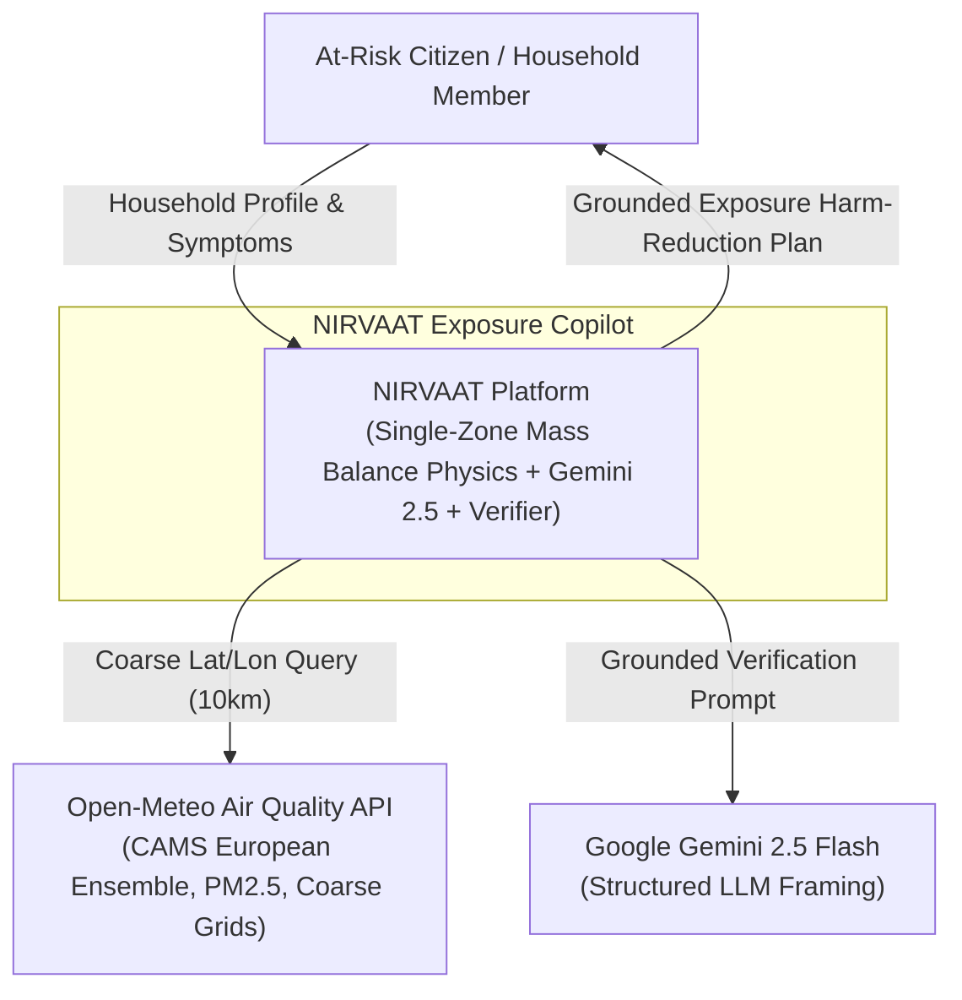
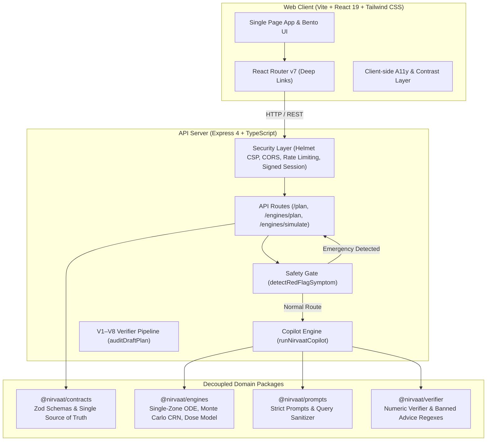
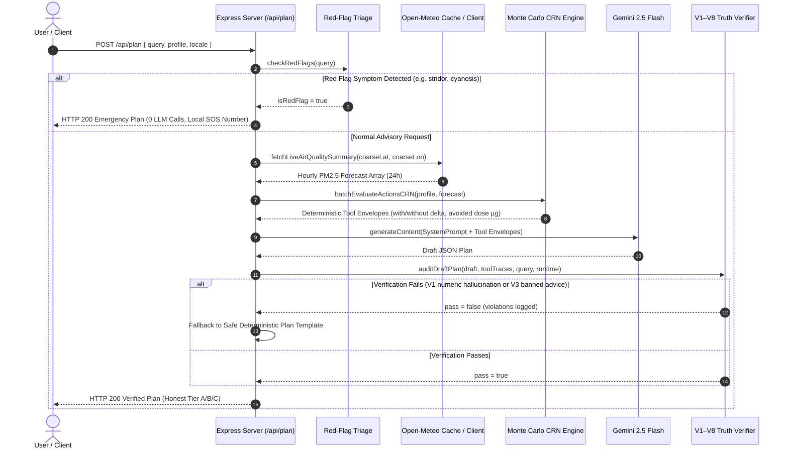

# NIRVAAT Architecture & System Blueprint

**Document Version**: 2.0.0  
**Status**: Production Verified  
**Date**: 2026-11-22  

---

## 1. System Context (C4 Level 1)

---

## 2. Container Diagram (C4 Level 2)

---

## 3. Plan Generation Sequence Diagram (C4 Level 3)

---

## 4. Architectural Invariants & Bounds

1. **Deterministic Physics First**: All quantitative metrics ($\mu\text{g/day}$, $\%$ reduction, time ranges) originate strictly from differential mass balance equations and Common Random Numbers.
2. **Zero-Trust AI Guardrails**: Gemini outputs cannot reach the user without passing the V1–V8 verification engine. Any numerical hallucination or banned advice triggers fallback to the deterministic template.
3. **Emergency Zero-Latency Circuit Breaker**: Severe medical distress symptoms immediately short-circuit to emergency guidance with zero LLM API dependency.
