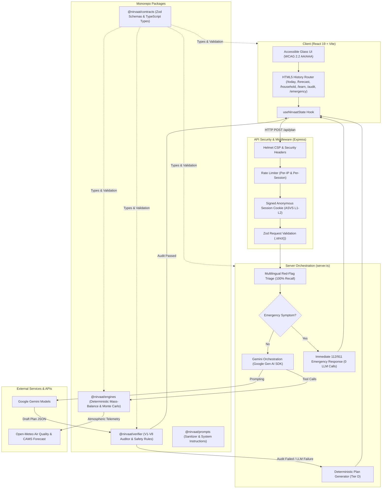
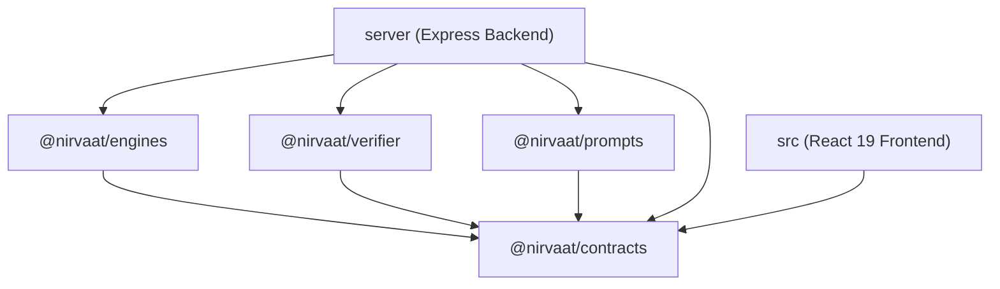
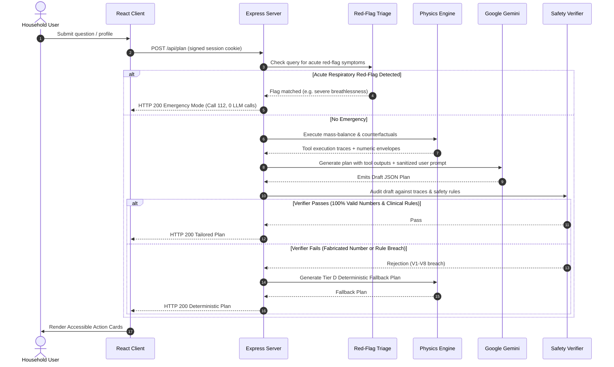

# NIRVAAT Architecture

This document describes the high-level system architecture of NIRVAAT, detailing its neuro-symbolic design, deterministic physics engines, automated safety verifier, and full-stack implementation.

---

## 1. System Overview

NIRVAAT is designed around a **neuro-symbolic boundary**:
- **Symbolic Core**: Physics-grounded mass-balance models, Monte Carlo simulations with Common Random Numbers (CRN), and deterministic verifiers.
- **Neural Layer**: Gemini LLM serving strictly for language synthesis, bilingual parity (`en-IN` / `hi-IN`), conversational formatting, and situational empathy.
- **Strict Verifier Gate**: Every LLM output is audited before leaving the server boundary. If an LLM fabricates a number or violates a clinical safety rule, the output is blocked and replaced with a deterministic fallback plan.

---

## 2. Package Dependency Architecture

The repository is structured as a pnpm workspace with strict dependency boundaries:

### Package Responsibilities

1. **`@nirvaat/contracts`**:
   - Single source of truth for all data shapes, Zod schemas, and TypeScript interfaces.
   - All server routes and client features derive types via `z.infer<typeof Schema>` (no duplicate interfaces).

2. **`@nirvaat/engines`**:
   - Deterministic single-zone indoor mass-balance physics.
   - Monte Carlo simulation with Common Random Numbers (CRN) using `seedrandom`.
   - Dynamic variance decomposition ensuring $\sum \text{variance\_share} = 100\%$.
   - Inversion timeline calculation and high-performance in-memory cache ($<0.1\text{ms}$ repeated lookups).

3. **`@nirvaat/verifier`**:
   - V1 Numeric Provenance Auditor: Matches all numeric claims in LLM text against engine tool envelopes.
   - V2 Free Option Inclusion: Enforces at least 1 free action per plan for equity.
   - V3 Medication Protection: Rejects medication cessation while permitting inhaled exposure reduction.
   - V4 Infant Mask Prohibition: Prohibits mask recommendations for children under 2 years.
   - V5 Banned Advice Detection: Flags ozonators, ionizers, and burning waste to clean air.
   - V6 Action Rank Order: Confirms descending cost-effectiveness order.
   - V7 Trace Reference Integrity: Verifies all `tool_ref` identifiers.
   - V8 Degradation Tier Alignment: Enforces schema completeness matching telemetry tiers A–D.
   - Multilingual Red-Flag Engine: Evaluates 65+ emergency queries with 100% recall.

4. **`@nirvaat/prompts`**:
   - Prompt injection sanitization: Neutralizes attempts to leak system instructions, override audit passes, or execute arbitrary code.
   - System prompts and structured JSON schema schemas for Gemini LLM calls.

---

## 3. Data Flow & Execution Lifecycle

---

## 4. Frontend Component Architecture

The frontend is modularized into feature boundaries:

- **`src/routes/`**: Route components corresponding to URL views (`TodayRoute`, `ForecastRoute`, `HouseholdRoute`, `LearnRoute`, `AuditRoute`, `EmergencyRoute`).
- **`src/features/today/`**: Core daily decision dashboard (`PlanRenderer`, `ActionCard`, `PlanAuditBadge`, `ChannelPreview`).
- **`src/features/forecast/`**: Inversion timeline chart, exposure ring, and hourly data tables.
- **`src/features/household/`**: Microenvironment twin simulator, dwelling form, and vulnerability selector.
- **`src/features/audit/`**: Session audit history, telemetry tier inspector, and verifier transparency logs.
- **`src/shared/`**: Common state hooks (`useNirvaatState`), error boundaries (`RouteErrorBoundary`), and contracts.
