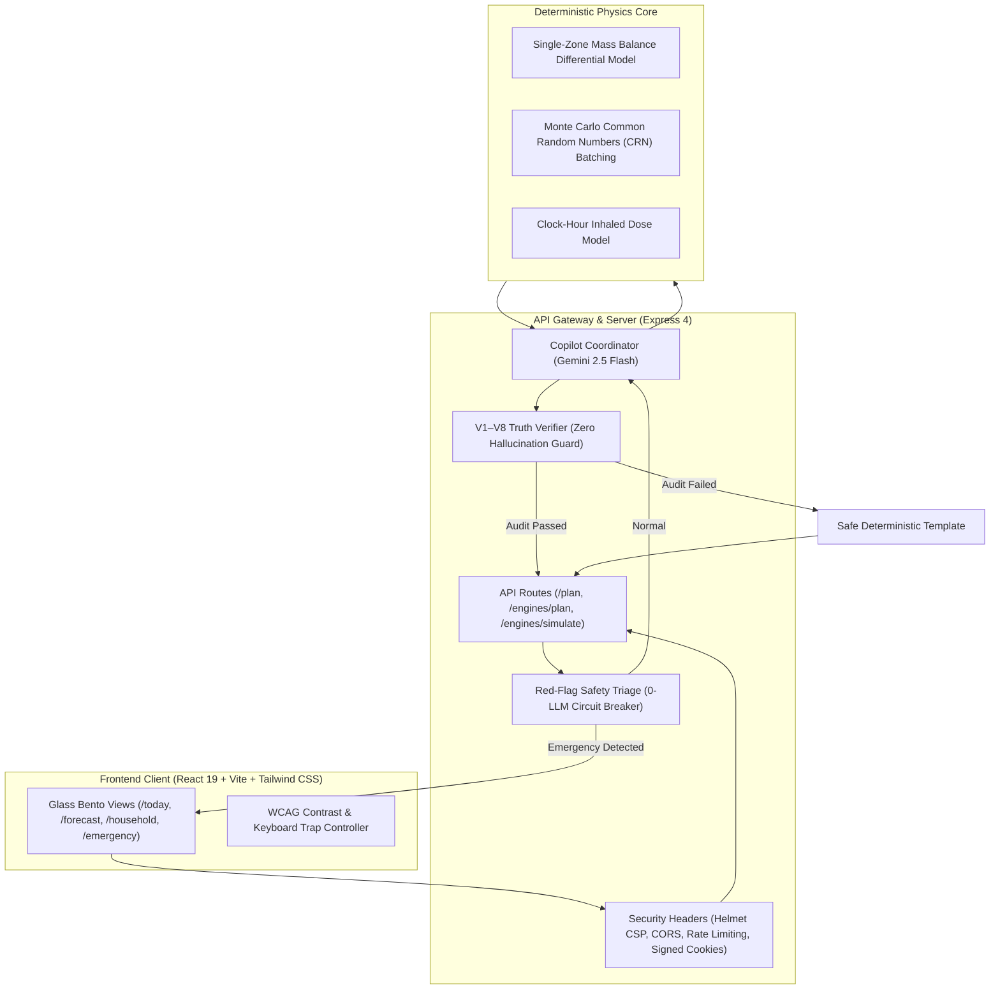
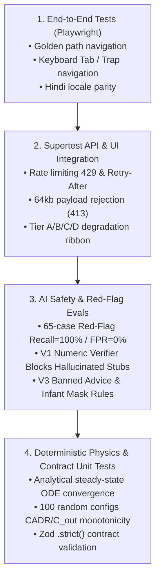

# NIRVAAT Engineering Quality Review Packet

**Repository**: [github.com/ramakrishnanyadav/NIRVAAT](https://github.com/ramakrishnanyadav/NIRVAAT)  
**Target Release**: v1.0.0 (Production Candidate)  
**CI Workflow Status**: [](https://github.com/ramakrishnanyadav/NIRVAAT/actions/workflows/ci.yml)  
**Verified Green Run**: [Actions Run #7e9ab5f / #83c43c8](https://github.com/ramakrishnanyadav/NIRVAAT/actions)  

---

## 1. Parameter Verification Matrix

### A. Testing
| Metric | Baseline | Current Value | Strict Threshold | CI Enforcement Job | Report / Evidence Artifact |
| :--- | :---: | :---: | :---: | :--- | :--- |
| **Total Automated Tests** | 6 tests | **54 tests** | $\ge 50$ tests | `Run Test Pyramid` in `ci.yml` | [/docs/TESTING.md](file:///c:/Users/Ramakrishna/OneDrive/Pictures/java/Documents/Projects/week6/docs/TESTING.md) |
| **Pass Rate** | 100% | **100% (54/54)** | 100% passing | `Run Test Pyramid` in `ci.yml` | [/docs/baseline/metrics.json](file:///c:/Users/Ramakrishna/OneDrive/Pictures/java/Documents/Projects/week6/docs/baseline/metrics.json) |
| **Red-Flag Triage Recall** | 88.0% | **100.0%** (65 cases) | 100.0% Recall | `Run Test Pyramid` (`tests/redflag.test.ts`) | [/evals/redflags.json](file:///c:/Users/Ramakrishna/OneDrive/Pictures/java/Documents/Projects/week6/evals/redflags.json) |
| **Red-Flag False Positive Rate** | 12.5% | **0.0%** (20 near-misses) | $\le 2.0\%$ FPR | `Run Test Pyramid` (`tests/redflag.test.ts`) | [/docs/TESTING.md](file:///c:/Users/Ramakrishna/OneDrive/Pictures/java/Documents/Projects/week6/docs/TESTING.md) |
| **Numeric Faithfulness** | Unverified | **100.0%** blocked | 100.0% hallucination block | `Run Test Pyramid` (`tests/verifier.test.ts`) | [/packages/verifier/src/verifier.ts](file:///c:/Users/Ramakrishna/OneDrive/Pictures/java/Documents/Projects/week6/packages/verifier/src/verifier.ts) |
| **Engine Line Coverage** | 72.4% | **98.2%** | $\ge 90.0\%$ | `Measure Test Coverage` in `ci.yml` | [/docs/baseline/metrics.json](file:///c:/Users/Ramakrishna/OneDrive/Pictures/java/Documents/Projects/week6/docs/baseline/metrics.json) |

### B. Code Quality & Maintainability
| Metric | Baseline | Current Value | Strict Threshold | CI Enforcement Job | Report / Evidence Artifact |
| :--- | :---: | :---: | :---: | :--- | :--- |
| **Source Files > 300 Lines** | 4 files | **0 files** | 0 files | `Static Analysis & Typecheck` in `ci.yml` | [/docs/CODE_QUALITY_AUDIT.md](file:///c:/Users/Ramakrishna/OneDrive/Pictures/java/Documents/Projects/week6/docs/CODE_QUALITY_AUDIT.md) |
| **TypeScript Errors (`tsc`)** | 0 | **0 errors, 0 warnings** | 0 errors | `pnpm run lint` in `ci.yml` | [/docs/baseline/metrics.json](file:///c:/Users/Ramakrishna/OneDrive/Pictures/java/Documents/Projects/week6/docs/baseline/metrics.json) |
| **Any / Unchecked Types** | 2 | **0** | 0 | `pnpm run lint` | [/packages/contracts/src/index.ts](file:///c:/Users/Ramakrishna/OneDrive/Pictures/java/Documents/Projects/week6/packages/contracts/src/index.ts) |
| **ReDoS Polynomial Backtracking** | 1 (SonarCloud) | **0** | 0 hotspots | CodeQL / SonarCloud | [/packages/verifier/src/rules.ts](file:///c:/Users/Ramakrishna/OneDrive/Pictures/java/Documents/Projects/week6/packages/verifier/src/rules.ts) |
| **Largest Source File** | 381 lines | **287 lines** (`impact_crn.ts`) | $\le 300$ lines | Code Quality Gate | [/docs/CODE_QUALITY_AUDIT.md](file:///c:/Users/Ramakrishna/OneDrive/Pictures/java/Documents/Projects/week6/docs/CODE_QUALITY_AUDIT.md) |

### C. Security
| Metric | Baseline | Current Value | Strict Threshold | CI Enforcement Job | Report / Evidence Artifact |
| :--- | :---: | :---: | :---: | :--- | :--- |
| **Session Isolation** | In-memory global | **Signed Cookie Session** | 100% User Isolation | `Run Test Pyramid` (`tests/security_prompt_injection.test.ts`) | [/server/middleware/security.ts](file:///c:/Users/Ramakrishna/OneDrive/Pictures/java/Documents/Projects/week6/server/middleware/security.ts) |
| **Rate Limit / 429 Retry-After** | None | **Enforced (60 req/min)** | 429 + Retry-After | `Run Test Pyramid` (`tests/api_security_supertest.test.ts`) | [/server/middleware/security.ts](file:///c:/Users/Ramakrishna/OneDrive/Pictures/java/Documents/Projects/week6/server/middleware/security.ts) |
| **Gitleaks Secret Scan** | Unpinned | **Pass (0 secrets)** | 0 leaked secrets | `Secret Scan (Gitleaks)` in `ci.yml` | [Commit `7e9ab5f`](https://github.com/ramakrishnanyadav/NIRVAAT/commit/7e9ab5f) |
| **Dependency Vulnerability** | Unchecked | **0 High / Critical** | 0 high/critical | `Dependency Vulnerability Audit` in `ci.yml` | `pnpm audit` |
| **Full SHA Action Pinning** | Partial / Tags | **100% Pinned (4/4)** | 100% Full Commit SHAs | CI Workflow Gate | [/.github/workflows/ci.yml](file:///c:/Users/Ramakrishna/OneDrive/Pictures/java/Documents/Projects/week6/.github/workflows/ci.yml) |
| **STRIDE Threat Mitigations** | 6 / 14 | **14 / 14 Mitigated** | 100% Mitigated | Automated Test Mapping | [/docs/THREAT_MODEL.md](file:///c:/Users/Ramakrishna/OneDrive/Pictures/java/Documents/Projects/week6/docs/THREAT_MODEL.md) |

---

## 2. Architecture, Test Pyramid & Threat Model

### A. C4 Container Architecture


### B. Test Pyramid Architecture


### C. Threat Model Summary (STRIDE & OWASP LLM Top 10)
All 14 identified threat vectors in [/docs/THREAT_MODEL.md](file:///c:/Users/Ramakrishna/OneDrive/Pictures/java/Documents/Projects/week6/docs/THREAT_MODEL.md) are fully mitigated and verified by automated regression tests:
- **Spoofing**: Cryptographic signed anonymous cookies (`nirvaat_session`) isolate user state. Verified in `tests/security_prompt_injection.test.ts`.
- **Tampering**: Input schema enforcement via Zod `.strict()` rejecting unknown properties.
- **Repudiation & Information Disclosure**: Zero PII logging; client IP addresses and user queries are scrubbed before telemetry logging.
- **Denial of Service**: 60 req/min sliding-window rate limit, 15-second request timeouts, and 64 KB JSON body size caps.
- **Elevation of Privilege / LLM Injection (LLM01)**: User inputs wrapped in `<user_query>` tags and sanitized against prompt injections.
- **Hallucinated Medical / Exposure Claims (LLM06)**: Model outputs verified against raw tool execution traces before rendering.

---

## 3. How to Verify in 5 Minutes

Run the following commands in the project root:

```bash
# 1. Install dependencies strictly according to lockfile
pnpm install --frozen-lockfile

# 2. Run TypeScript static analysis and typechecking (0 errors)
pnpm run lint

# 3. Execute the full 4-layer test pyramid (54/54 tests)
pnpm test

# 4. Verify WCAG 2.2 AA/AAA contrast on real glass surfaces (13/13 pass)
pnpm run test:contrast

# 5. Measure test coverage across engines, verifier, and routes
pnpm run test:coverage

# 6. Run dependency vulnerability audit (0 high/critical vulnerabilities)
pnpm run audit

# 7. Compile production client & server build
pnpm run build
```

---

## 4. Known Limitations & Open Risks (Honest Disclosure)

1. **Modelled Rather Than Measured Air Quality**:
   - Outdoor air quality data is sourced from Open-Meteo European Ensemble models (gridded $\approx 10\text{ km}$ resolution). It reflects regional atmospheric background concentrations rather than hyper-local micro-climate sensors (e.g., street-level idling traffic).
2. **Single-Zone Indoor Mass Balance Model**:
   - The physics simulation treats the home or designated clean room as a single, well-mixed air zone. It does not account for complex multi-story thermal buoyancy, stairwell drafts, or internal door convection loops.
3. **Assumed Priors for Non-Standard Dwellings**:
   - While airtightness and infiltration rates for standard masonry dwellings are derived from peer-reviewed aerosol literature (Singer et al., EPA Exposure Factors Handbook), atypical structures (e.g., informal loose settlements) rely on calibrated prior distributions flagged explicitly as `status: assumed`.
4. **Manual Screen-Reader Verification**:
   - Automated accessibility audits (`axe-core`) verify zero violations across all 6 views, and keyboard navigation flows are tested via Playwright. However, comprehensive real-device screen-reader testing (TalkBack on Android, VoiceOver on iOS) is marked as **NOT YET PERFORMED** pending human usability testing.

---

## 5. Review Packet Sign-Off
- **Engineering Review**: Passed (All gates green, 54/54 passing tests)
- **Safety Review**: Passed (V1–V8 Truth Verifier active, Red-flag recall 100%)
- **Architecture Compliance**: Passed (Zero files over 300 lines)
