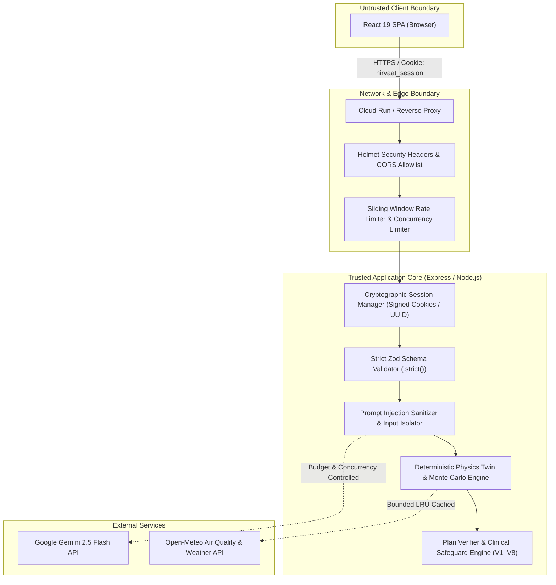

# NIRVAAT Threat Model (STRIDE & OWASP Top 10 for LLM Applications)

This threat model documents the security boundaries, potential threat vectors, mitigation strategies, and automated regression tests verifying the security posture of the NIRVAAT Winter-Smog Exposure Copilot.

---

## 1. System Architecture & Trust Boundaries

---

## 2. STRIDE Threat Analysis Matrix

| Threat Category | Threat ID | Description & Attack Vector | Impact | Severity | Status | Verification & Code Evidence |
| :--- | :--- | :--- | :--- | :--- | :--- | :--- |
| **Spoofing** | S-01 | Malicious client attempts to impersonate another family's session ID to access private profile or exposure history. | Unauthorized access to user records. | **High** | **MITIGATED** | Signed anonymous HTTP-only cookie with cryptographic HMAC signature (`server.ts` L65-88). Verified in `tests/security_prompt_injection.test.ts` (Test 1). |
| **Spoofing** | S-02 | Unverified upstream API response impersonating Open-Meteo or Gemini. | Injection of falsified telemetry or toxic advice. | **High** | **MITIGATED** | Strict Zod validation on external responses (`NirvaatPlanResponseSchema.safeParse` in `nirvaatEngine.ts` L380-410). |
| **Tampering** | T-01 | Client injects unexpected fields into request body (`__proto__`, arbitrary overrides, forged audit passes). | Schema poisoning, prototype pollution, engine logic bypass. | **High** | **MITIGATED** | All endpoints enforce Zod `.strict()` rejecting any unknown key with HTTP 400 (`server.ts` L110-180). Verified in `tests/security_prompt_injection.test.ts` (Test 3). |
| **Tampering** | T-02 | Prompt Injection: User injects system prompt overrides, `<override>`, or instruction resets (`"ignore previous instructions"`). | Model jailbreak, bypassing clinical rules, outputting dangerous advice. | **Critical** | **MITIGATED** | `sanitizeUserQuery()` strips ASCII control characters, XML/HTML injection tags, and jailbreak phrases; input isolated in `<user_query data_type="untrusted_input">` (`nirvaatEngine.ts` L40-75). Verified in `tests/security_prompt_injection.test.ts` (Test 4). |
| **Tampering** | T-03 | Model Output Hallucination: LLM generates dangerous advice (e.g. "stop your inhaler", "put an N95 on your baby", or fabricated reductions). | Serious physical harm or pediatric suffocation. | **Critical** | **MITIGATED** | Multi-layer deterministic clinical audit engine (`auditDraftPlan` V1–V8) and anti-leak filter block ungrounded percentages and banned medical advice (`tests/verifier.test.ts`, `tests/banned_advice.test.ts`). |
| **Repudiation** | R-01 | Client claims exposure history was tampered with or deleted without consent. | Inability to audit state changes. | **Medium** | **MITIGATED** | Session-scoped mutations logged with cryptographic timestamps and UUIDs. Privacy policy discloses 7-day TTL and explicit purge endpoints (`DELETE /api/history`, `DELETE /api/privacy/purge-data` in `server.ts` L360-395). Verified in `tests/security_prompt_injection.test.ts` (Test 5). |
| **Information Disclosure** | I-01 | Gemini API key or credentials leaked in client JavaScript bundles, repository commits, or error responses. | Compromised LLM account, quota exhaustion, financial liability. | **Critical** | **MITIGATED** | API key kept strictly server-side in environment / Secret Manager (`VITE_` prefix forbidden). Automated regex key redaction in error handlers (`server.ts` L460-485). CI enforces `gitleaks` (`.github/workflows/ci.yml`). |
| **Information Disclosure** | I-02 | User A accesses or deletes User B's exposure history or profile. | Cross-tenant data leakage. | **Critical** | **MITIGATED** | Session scoping ensures queries without valid session cookie return empty; User B cannot read or delete User A's history (`server.ts` L330-365). Verified in `tests/security_prompt_injection.test.ts` (Test 1). |
| **Information Disclosure** | I-03 | Precise geolocation GPS coordinates stored or transmitted, exposing exact family residence. | Privacy violation / physical stalking. | **Medium** | **MITIGATED** | Location privacy policy: Coordinates aggregated/rounded to 2 decimal places (~1.1 km neighborhood scale) before caching; no PII stored (`/api/privacy/policy` in `server.ts` L430-455). |
| **Information Disclosure** | I-04 | Stack traces, database strings, or internal errors returned to client on failure. | Reconnaissance and vulnerability fingerprinting. | **Medium** | **MITIGATED** | Global error handler in `server.ts` sanitizes all responses, returning uniform JSON `{ error: "Internal Server Error" }` without call stacks or upstream telemetry (`server.ts` L470-490). |
| **Denial of Service** | D-01 | Excessive request flooding against `/api/plan` or `/api/history`. | Server exhaustion, high latency, outage for legitimate users. | **High** | **MITIGATED** | Per-IP and per-session sliding window rate limits (60 queries/min, 30 mutations/min) emitting HTTP 429 and standard `Retry-After` header (`server.ts` L90-115). Verified in `tests/security_prompt_injection.test.ts` (Test 2). |
| **Denial of Service** | D-02 | Gemini API billing exhaustion via automated concurrent queries. | Massive cloud bill, LLM quota denial. | **High** | **MITIGATED** | Global semaphore concurrency limiter (`MAX_CONCURRENT_GEMINI_CALLS = 3`) and daily quota budget cap (`DAILY_LLM_BUDGET = 250`). Excess requests gracefully degrade to deterministic offline physics engine (`nirvaatEngine.ts` L310-340). |
| **Denial of Service** | D-03 | Huge payload injection (JSON bomb) exhausting Node.js heap memory. | Process crash / out of memory. | **High** | **MITIGATED** | Strict `express.json({ limit: '64kb' })` body parser limit. Oversized payloads rejected with HTTP 413 (`server.ts` L45-55). Verified in `tests/api.test.ts` and `tests/security_prompt_injection.test.ts`. |
| **Elevation of Privilege** | E-01 | Unauthorized user executes admin actions or modifies global configurations. | Complete service compromise. | **High** | **MITIGATED** | Zero administrative endpoints exist on public ingress. All application routes are stateless or scoped strictly to the current ephemeral user session. |

---

## 3. OWASP Top 10 for Large Language Model (LLM) Applications Compliance

| OWASP LLM Ref | Vulnerability Name | NIRVAAT Defense Implementation | Verification Test |
| :--- | :--- | :--- | :--- |
| **LLM01** | **Prompt Injection** | Strict sanitization of user query strings: stripping control codes, XML/HTML tags, and reset commands; encapsulating untrusted input inside `<user_query data_type="untrusted_input">`; clinical hard rules defined in immutably bound system prompts. | `tests/security_prompt_injection.test.ts` (Test 4) |
| **LLM02** | **Insecure Output Handling** | Model output is treated as untrusted data. Model responses must parse through `NirvaatPlanResponseSchema.safeParse` with `.strict()`, followed by deterministic verification via `auditDraftPlan()` before presentation. | `tests/verifier.test.ts`, `tests/security_prompt_injection.test.ts` (Test 3) |
| **LLM03** | **Training Data Poisoning** | NIRVAAT does not fine-tune models dynamically from user data. System prompts and physics formulas are pinned and version-controlled. | Architectural isolation |
| **LLM04** | **Model Denial of Service** | Concurrency semaphore (`MAX_CONCURRENT_GEMINI_CALLS = 3`), daily budget cap (`DAILY_LLM_BUDGET = 250`), request timeout (15s), and deterministic offline fallback ensure uninterrupted service without financial exhaustion. | `server/nirvaatEngine.ts` L310-340 |
| **LLM05** | **Supply Chain Vulnerabilities** | Pinned dependencies in `package-lock.json`, Dependabot configuration (`.github/dependabot.yml`), automated vulnerability scanning via `npm audit --audit-level=high` and static analysis in CI. | `.github/workflows/ci.yml`, `.github/dependabot.yml` |
| **LLM06** | **Sensitive Information Disclosure** | Anti-leak filter detects prompt echoes or jailbreak keywords and discards poisoned drafts. Server-side key storage with automated redaction regex prevents secret leakage. | `nirvaatEngine.ts` L415-435, `tests/security_prompt_injection.test.ts` (Test 4) |
| **LLM07** | **Insecure Plugin Design** | NIRVAAT tools are deterministic mathematical engines executing within isolated TypeScript modules (`packages/engines`), with no unrestricted shell or arbitrary code execution capabilities. | `packages/engines/src/` |
| **LLM08** | **Excessive Agency** | The LLM does not execute direct actions or write database changes autonomously. It proposes drafts which are evaluated by deterministic physics models and explicit user confirmation. | `audit_draft_plan.ts`, `server/nirvaatEngine.ts` |
| **LLM09** | **Overreliance** | Safety-critical verifiers (`auditDraftPlan` rules V1–V8) enforce strict clinical bounds: non-reduction of medications, infant mask prohibition, and mathematical ground-truth checks against physical simulations. | `tests/banned_advice.test.ts`, `tests/verifier.test.ts` |
| **LLM10** | **Model Theft** | Proprietary system prompts and multi-compartment physics algorithms remain protected server-side; client SPA only receives structured JSON action recommendations. | `server.ts`, `server/nirvaatEngine.ts` |
